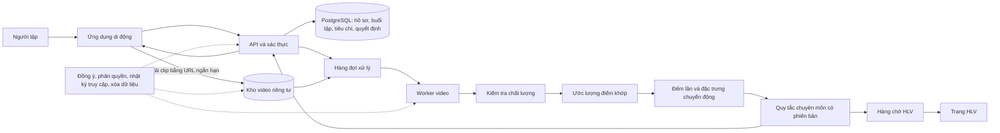

# Đánh giá kỹ thuật và lộ trình triển khai: CalisCoaching

**Ngày rà soát:** 26/10/2026  
**Mục tiêu tài liệu:** phác thảo cách triển khai kỹ thuật cho bản thử nghiệm calisthenics, nêu lựa chọn kiến trúc và những phần cần kiểm chứng trước khi tự động hóa.

## 1. Kết luận kỹ thuật

Đề tài khả thi về mặt kỹ thuật nếu tách thành từng năng lực và giới hạn rõ điều AI được phép làm. Ứng dụng ghi buổi tập, lưu tiến độ, phát clip cho huấn luyện viên và áp dụng bộ quy tắc chuyên môn không phải bài toán công nghệ mới. Phần khó là biến một video quay bằng điện thoại trong điều kiện không kiểm soát thành một nhận xét kỹ thuật đủ chính xác để ảnh hưởng đến chương trình tập.

Vì vậy, độ khó không nằm chủ yếu ở việc “gọi một API AI”. Nó nằm ở việc:

- Chuyên gia cùng hiểu và chấm nhất quán thế nào là một lần tập hợp lệ và một lỗi quan trọng.
- Hệ thống biết khi nào video không đủ điều kiện để nhận xét.
- Mô hình hoạt động trong nhiều góc quay, điện thoại, không gian và năng lực người tập.
- Phản hồi không khiến người mới tập quá sức hoặc tăng cấp sai.
- Video và dữ liệu sức khỏe được xử lý an toàn, có quyền sử dụng rõ ràng.

**Khuyến nghị:** xây một dịch vụ chương trình có HLV giám sát trước; ghi nhật ký và quy tắc quyết định rõ ràng; sau đó kiểm tra AI ở chế độ “chạy nền” và so sánh với HLV. Chưa cần huấn luyện mô hình riêng, hội thoại AI tự do, phản hồi trực tiếp từng khung hình hoặc kế hoạch phục hồi liên môn.

## 2. Phân tách các năng lực kỹ thuật

Không nên gộp “AI phân tích video” thành một tính năng duy nhất. Có ít nhất năm tầng khác nhau:

| Tầng | Đầu vào | Đầu ra | Độ khó tương đối | Khuyến nghị giai đoạn đầu |
|---|---|---|---|---|
| 1. Chất lượng video | Clip, thông tin động tác, góc quay | Đạt / quay lại / HLV xem | Trung bình | Làm sớm; đây là điều kiện để mọi tầng sau hoạt động. |
| 2. Ước lượng tư thế | Các khung hình | Các điểm khớp và độ tin cậy | Trung bình | Dùng mô hình có sẵn làm baseline; chưa coi điểm khớp là nhận xét kỹ thuật. |
| 3. Phát hiện và đếm lần | Chuỗi điểm khớp theo thời gian | Số lần, thời điểm đầu-cuối từng lần | Trung bình–cao | Bắt đầu bằng một động tác và thuật toán trạng thái có thể kiểm tra. |
| 4. Nhận diện sai lệch kỹ thuật | Chuỗi tư thế và tiêu chí chuyên gia | Mã lỗi quan sát được, mức tin cậy | Cao | Chỉ nhận diện lỗi nhìn thấy được và đã kiểm chứng; khi chưa chắc thì từ chối kết luận. |
| 5. Quyết định bài tiếp theo | Lịch sử, kỹ thuật, cảm nhận và quy tắc | Giữ bài / đề xuất đổi mức / HLV duyệt | Cao về chuyên môn và an toàn | Dùng bộ quy tắc chuyên gia, phiên bản hóa, HLV phê duyệt trong pilot. |

Ước lượng tư thế chỉ trả lời “các điểm cơ thể có thể đang ở đâu”. Nó không biết tự thân rằng một lần chống đẩy đạt chuẩn. Ví dụ, ML Kit trả về 33 điểm cơ thể và độ tin cậy hiện diện trong khung hình; tài liệu của Google ghi rõ mô hình không tự gắn ý nghĩa cho tư thế. API này hiện ở trạng thái beta, chỉ theo dõi một người và yêu cầu khuôn mặt hiện diện. Đây là các giới hạn cần cân nhắc với bài tập nằm thấp như chống đẩy. [Tài liệu Google ML Kit Pose Detection](https://developers.google.com/ml-kit/vision/pose-detection)

## 3. Phạm vi sản phẩm kỹ thuật nên làm trước

### Bản thử nghiệm có HLV, chưa phụ thuộc AI

Nên có các chức năng sau trước khi xây pipeline nhận diện tự động:

1. Đăng ký người trưởng thành, mục tiêu, kinh nghiệm, dụng cụ, thời gian có thể tập và đồng ý dữ liệu theo từng mục đích.
2. Đánh giá đầu vào bằng hướng dẫn và tiêu chí đã được HLV duyệt.
3. Một lộ trình có phiên bản; mỗi giai đoạn ghi rõ điều kiện vào, điều kiện hoàn thành, giới hạn và trường hợp cần HLV.
4. Nhật ký buổi tập gồm bài, set/lần, độ khó cảm nhận, mức mệt/đau tự báo cáo và ghi chú.
5. Gửi clip riêng tư theo từng set hoặc bài cần đánh giá; HLV phản hồi bằng các mã tiêu chí có cấu trúc thay vì chỉ gửi đoạn chat tự do.
6. Trang HLV để xem người đang chờ, clip cần ưu tiên, lịch sử, phản hồi cũ và lý do hệ thống đề xuất giữ/đổi bài.
7. Luồng yêu cầu hỗ trợ, báo đau/sự cố, tạm dừng chương trình, tải/xóa dữ liệu và xử lý yêu cầu quyền riêng tư.

### Bản đầu có AI hỗ trợ

Sau khi luồng thủ công chạy được, thêm theo thứ tự:

1. Kiểm tra clip có một người, đủ sáng, đủ cơ thể trong khung, không quá nhòe và đủ độ phân giải.
2. Trích xuất điểm khớp trên clip của một động tác.
3. Đếm lần và tìm đoạn clip cần HLV xem.
4. Tạo tóm tắt kỹ thuật có mã lỗi và mức tin cậy; HLV duyệt trước khi người tập nhận.
5. Chỉ sau khi kiểm chứng mới đề xuất trạng thái tiến độ. Trong pilot, HLV vẫn là người phê duyệt quyết định chuyển mức.

Không để LLM tự tạo tiêu chuẩn kỹ thuật hoặc tự kê bài. Nếu dùng LLM, chỉ dùng để diễn đạt lại thông tin có cấu trúc đã được phê duyệt, với mẫu câu an toàn; không cho mô hình tự suy diễn chấn thương, chẩn đoán hay khuyến nghị y tế.

## 4. Kiến trúc tham chiếu cho MVP

Giữ kiến trúc dạng **modular monolith**: một backend nghiệp vụ với các mô-đun rõ ranh giới, một dịch vụ xử lý clip chạy nền, một kho dữ liệu quan hệ và một kho lưu video riêng tư. Chưa cần microservices.



### Thành phần và lựa chọn triển khai

| Thành phần | Mục đích | Lựa chọn khởi đầu |
|---|---|---|
| Ứng dụng | Onboarding, hướng dẫn tập, ghi log, quay/tải clip, phản hồi | Làm concierge bằng web/form trước. Khi cần camera và thông báo, chọn React Native hoặc Flutter theo kỹ năng đội; không viết hai ứng dụng song song. |
| Backend | Đăng nhập, hồ sơ, chương trình, trạng thái buổi, API cho ứng dụng và HLV | Python + FastAPI là lựa chọn hợp lý nếu cùng đội xây pipeline CV; dùng modular monolith, xác thực rõ vai trò người tập/HLV/quản trị. |
| Cơ sở dữ liệu | Lưu dữ liệu nghiệp vụ có cấu trúc | PostgreSQL. Không nhét clip vào database; database chỉ giữ metadata và khóa đối tượng. |
| Video | Lưu clip cần HLV xem/xử lý | Kho object riêng tư, mã hóa, không có URL công khai; upload trực tiếp bằng URL ký ngắn hạn để backend không phải chuyển toàn bộ file. Chọn vùng lưu và nhà cung cấp sau khi rà soát chuyển dữ liệu. |
| Xử lý nền | Xếp hàng, giải mã, tạo khung hình, suy luận, phản hồi trạng thái | Một worker Python cùng hàng đợi đơn giản hoặc managed queue; không cần GPU trước khi đo được tải và thời gian thực tế. |
| Mô hình tư thế | Trích điểm cơ thể từ ảnh/video | Thử MediaPipe Pose Landmarker và ít nhất một baseline khác trên clip mục tiêu; chọn theo chất lượng, license, thiết bị và khả năng vận hành. MediaPipe hỗ trợ ảnh/video và xuất landmark ảnh cùng tọa độ thế giới 3D ước lượng; đây vẫn là điểm khớp, không phải phân loại kỹ thuật. Model card liệt kê điều kiện ngoài phạm vi như nhiều người, đầu không nằm trong khung và yêu cầu độ sâu chính xác theo đơn vị mét; có cảnh báo không dùng model cho quyết định trọng yếu đến tính mạng. Rà soát license của model, code và assets riêng trước khi phân phối. [Google AI Edge MediaPipe Pose Landmarker](https://developers.google.com/edge/mediapipe/solutions/vision/pose_landmarker), [Model Card BlazePose](https://storage.googleapis.com/mediapipe-assets/Model%20Card%20BlazePose%20GHUM%203D.pdf) |
| Đối chứng native iOS | So chất lượng trên cohort chủ yếu dùng iPhone | Apple Vision có API ước lượng body pose 2D/3D native; đầu ra và pipeline khác Android nên phù hợp làm spike nếu pilot chủ yếu iOS, không nhất thiết là kiến trúc chung đa nền tảng. [Apple Vision 2D](https://developer.apple.com/documentation/vision/detecting-human-body-poses-in-images), [Apple Vision 3D](https://developer.apple.com/documentation/vision/identifying-3d-human-body-poses-in-images) |
| Trang HLV | Duyệt ca, xem clip, áp dụng rubric, sửa gợi ý | Web app nội bộ với quyền truy cập theo ca được phân công, log ai xem gì và xuất báo cáo tóm tắt. |
| Phân tích sản phẩm | Đo hoàn thành, lỗi upload, thời gian HLV và chi phí | Chỉ ghi sự kiện tối thiểu; không gửi clip, tên file hoặc thông tin sức khỏe sang công cụ analytics mặc định. |

Với video gửi HLV, xử lý trên server có thể là prototype đơn giản nhất vì clip đã phải được tải lên. Nhưng suy luận trên thiết bị có thể giảm lượng dữ liệu gửi lên và độ trễ. Suy luận on-device không xóa nhu cầu tải video thô nếu HLV vẫn phải xem clip. Nên benchmark cả hai sau khi có luồng quay ổn định, thay vì chọn theo tuyên bố marketing của SDK.

## 5. Luồng xử lý một clip

1. **Chọn bài và hướng dẫn quay:** hiển thị sơ đồ vị trí máy, khung cơ thể cần thấy, cách cố định điện thoại, ánh sáng và yêu cầu quay riêng người tập. Khuyến nghị góc quay ban đầu phải theo từng động tác và được thử nghiệm; một góc chung cho mọi bài sẽ tạo lỗi.
2. **Quay clip ngắn:** mỗi clip một bài/hoặc một set, không tải cả buổi hàng chục phút. Cho xem lại và xóa clip ngay trước khi gửi.
3. **Kiểm tra trên máy:** xác nhận clip có thể phát, giới hạn dung lượng/thời lượng cấu hình được, xoay hình đúng, không vô tình gửi ảnh/video thư viện nếu người dùng chọn quay trực tiếp.
4. **Upload bảo mật:** API cấp URL ngắn hạn gắn với đúng phiên; tên đối tượng được sinh ngẫu nhiên; không dùng tên, email hoặc mã tài khoản trong tên file.
5. **Kiểm tra server:** xác thực người gửi và quyền sở hữu ca; kiểm tra nội dung thực chứ không chỉ đuôi/MIME do client khai báo; giới hạn kích thước và thời lượng; giải mã trong môi trường giới hạn tài nguyên; loại bỏ metadata không cần thiết; không mở clip như nội dung thực thi.
6. **Kiểm tra chất lượng:** đo landmark visibility/confidence, số người, độ che khuất, blur, kích thước người trong frame và thời lượng. Kết quả là `accepted`, `recapture` hoặc `coach_review`, không phải một con số độ tin cậy chung chung.
7. **Ước lượng pose:** lấy mẫu frame theo khoảng thời gian đã đo thử. Tài liệu ML Kit gợi ý người cần đủ số pixel và toàn thân hiện rõ; điều kiện này phải biến thành hướng dẫn quay và test thực tế. [Giới hạn đầu vào ML Kit](https://developers.google.com/ml-kit/vision/pose-detection)
8. **Đếm lần:** làm trơn tọa độ theo thời gian, tạo góc/đặc trưng phù hợp với động tác, xác định các trạng thái lên/xuống bằng state machine có hysteresis, rồi gom sự kiện thành từng lần. Không đếm độc lập từng frame.
9. **Nhận diện kỹ thuật:** chạy các phép kiểm tra chuyên biệt, ví dụ lỗi có thể quan sát ở mặt phẳng quay được chọn. Mỗi lỗi có mã, mức nghiêm trọng, confidence đã hiệu chỉnh và đoạn thời gian minh chứng.
10. **Áp dụng quy tắc:** đọc kết quả AI cùng log tập, mục tiêu, cảm nhận của người tập và dấu hiệu cần xem xét. Ghi lại quy tắc/phiên bản nào đưa ra đề xuất và dữ liệu nào được dùng.
11. **HLV duyệt:** các clip không chắc, lỗi nặng, đau/mệt bất thường, mâu thuẫn giữa AI và nhật ký hoặc ca được chọn kiểm tra chất lượng vào hàng chờ.
12. **Trả kết quả và xóa:** người tập nhận lý do cụ thể; video được xóa theo thời hạn đã công bố, trừ khi người dùng đồng ý lưu cho HLV/huấn luyện mô hình theo mục đích riêng.

Hướng dẫn bảo mật upload nên theo nguyên tắc chỉ cho phép định dạng cần dùng, đổi tên file, kiểm tra file thật, giới hạn kích thước, xác thực/quyền truy cập và tách lưu trữ khỏi nội dung công khai. Không tin riêng vào phần mở rộng hoặc header MIME của file. [OWASP File Upload Cheat Sheet](https://cheatsheetseries.owasp.org/cheatsheets/File_Upload_Cheat_Sheet.html)

## 6. Thuật toán và hợp đồng đầu ra

### Đếm lần

Đếm lần là bài toán hẹp hơn nhận diện “form tốt”. Với một bài, nhóm có thể dùng state machine minh bạch:

- Tính góc/tọa độ tương đối từ các landmark đã được xác nhận nhìn thấy.
- Làm trơn nhiễu nhưng giữ đủ tốc độ để không mất lần tập nhanh.
- Chuyển qua các trạng thái chuẩn hóa theo động tác, ví dụ vị trí đầu, pha hạ, đáy, pha nâng và vị trí hoàn tất.
- Chỉ tăng bộ đếm sau chu kỳ hợp lệ; chặn dao động ở biên bằng hysteresis và thời lượng tối thiểu.
- Nếu landmark chính biến mất hoặc confidence giảm, kết thúc phân tích bằng trạng thái “không đủ dữ liệu”, không tự điền chuyển động.

Ngưỡng góc không nên được đặt bằng cách nhìn một clip mẫu. HLV cần định nghĩa biến thiên nào chấp nhận được; sau đó so với nhãn độc lập trên nhiều người, nhiều điện thoại và tốc độ khác nhau.

### Nhận diện lỗi kỹ thuật

Mỗi lỗi cần một đặc tả máy đọc được:

- `issue_code`: mã ổn định, ví dụ `insufficient_depth` nếu tiêu chí này được HLV xác nhận.
- `visible_evidence`: landmark/thời gian nào tạo ra nhận định.
- `required_view`: góc nhìn mà lỗi có thể quan sát.
- `severity`: mức độ cần chú ý theo rubric chuyên môn.
- `confidence`: mức tin cậy đã hiệu chỉnh trên tập validation, không phải raw score của pose model.
- `fallback`: quay lại, HLV xem, hoặc không đưa nhận xét.
- `coach_override_reason`: lý do sửa kết quả AI để dùng cho phân tích lỗi.

Không suy luận về bộ phận bị che khuất hoặc về nguy cơ chấn thương chỉ từ dáng nhìn. Nếu góc camera không quan sát được tiêu chí, sản phẩm phải nói rõ “không đánh giá được mục này”.

### Đầu ra ổn định cho ứng dụng

Backend nên trả kết quả dạng cấu trúc trước, rồi ứng dụng mới trình bày:

```json
{
  "analysis_status": "coach_review",
  "exercise_id": "push_up_level_1",
  "reps_detected": 8,
  "capture_quality": "accepted_with_limits",
  "issues": [
    {
      "code": "range_of_motion_unclear",
      "severity": "review",
      "confidence": 0.61,
      "start_ms": 5200,
      "end_ms": 8100
    }
  ],
  "progression_decision": "human_approval_required",
  "reason_codes": ["low_confidence_on_depth", "coach_rule_review"],
  "model_version": "pose-baseline-2026-10",
  "rule_version": "pushup-progression-v1"
}
```

Đây là ví dụ cấu trúc, không phải rubric chuyên môn đã duyệt. Mọi kết quả cần mang `model_version`, `rule_version`, trạng thái xử lý và lý do; tránh lưu một trường văn bản duy nhất kiểu “AI nói form sai” mà không thể giải thích lại.

### Bộ quy tắc tăng cấp

Tách recommender khỏi model CV. Rule engine nhận dữ liệu có cấu trúc rồi đưa ra trạng thái:

- `hold`: tiếp tục giai đoạn, chưa đủ bằng chứng chuyển mức.
- `candidate`: đủ dữ liệu để HLV hoặc quy tắc an toàn xem xét.
- `approved`: HLV/luồng điều kiện đã duyệt chuyển mức.
- `paused`: đau, sự cố, dữ liệu không nhất quán hoặc yêu cầu người tập.
- `recapture`: chưa thể đánh giá do video.

Trong MVP, `approved` nên cần bước HLV xác nhận hoặc điều kiện rất hẹp được hội đồng chuyên môn duyệt trước. Không để mô hình pose hoặc LLM trực tiếp thay đổi tải tập.

## 7. Mô hình dữ liệu nên có từ đầu

Ít nhất cần tách các thực thể sau:

- `user_profile`: mục tiêu, kinh nghiệm, dụng cụ, lựa chọn quyền riêng tư.
- `consent_record`: mục đích, phiên bản thông báo, thời gian đồng ý/rút lại, kênh lấy đồng ý.
- `exercise_catalog`: động tác, biến thể, hướng dẫn quay, yêu cầu dụng cụ.
- `skill_criteria`: tiêu chí đầu vào/ra, mã lỗi, giới hạn an toàn, phiên bản và người duyệt.
- `program_version`: nội dung buổi tập, tiến trình, quy tắc chuyển mức và ngày hiệu lực.
- `training_session` / `set_result`: bài được giao, số lần người tập ghi, RPE/đau/mệt, thời gian.
- `media_asset`: khóa file ngẫu nhiên, owner, trạng thái upload/xử lý, thời hạn xóa, quyền truy cập.
- `analysis_run`: model version, preprocessing version, kết quả, lỗi, confidence, thời gian xử lý.
- `coach_review`: kết quả HLV, mã lỗi, đoạn thời gian, override và lý do.
- `progression_decision`: trạng thái quyết định, reason codes, dữ liệu đầu vào rút gọn, phiên bản ruleset, người phê duyệt.
- `incident_report`: báo đau/sự cố, mức độ, người xử lý, hành động và thời gian đóng.

Không cần lưu toàn bộ từng keypoint từng frame vô hạn. Lưu đầu ra tổng hợp và đoạn minh chứng tối thiểu cho nhiệm vụ; nếu lưu chuỗi keypoint để debug, phải có mục đích, quyền truy cập và hạn xóa riêng. Kết quả pose cũng có thể gắn ngược với một người nên không mặc định nó đã ẩn danh.

## 8. Đánh giá mô hình và nghiệm thu kỹ thuật

### Tạo tập nhãn

Trước khi huấn luyện hoặc điều chỉnh mô hình:

1. Viết rubric và hướng dẫn chấm từng lỗi.
2. Hai HLV chấm độc lập một phần dữ liệu; ghi tỷ lệ bất đồng và thống nhất quy tắc giải quyết.
3. Gắn nhãn: clip hợp lệ/không hợp lệ, mốc thời gian từng lần, số lần hợp lệ, lỗi quan sát được, độ nghiêm trọng, góc quay và chất lượng hình.
4. Tách tập train/validation/test theo **người tập hoặc phiên**, không tách frame ngẫu nhiên; nếu cùng một người xuất hiện ở train và test thì kết quả dễ quá lạc quan.
5. Ghi nguồn dữ liệu, mục đích đồng ý, phạm vi sử dụng và quyền xóa; không lấy video mạng làm dữ liệu nếu quyền không rõ.

### Chỉ số cần báo cáo

- **Đếm lần:** mean absolute error, tỷ lệ đếm chính xác, tỷ lệ lệch một lần, false positive/false negative và kết quả theo từng động tác.
- **Lỗi kỹ thuật:** precision/recall/F1 riêng từng lỗi; tỷ lệ bỏ sót lỗi nghiêm trọng; ma trận nhầm lẫn; mức đồng thuận giữa AI với từng HLV và giữa HLV với nhau.
- **Từ chối đánh giá:** tỷ lệ clip được xử lý, cần quay lại, chuyển HLV; đo đồng thời độ chính xác trên phần được nhận và tỷ lệ bao phủ người dùng.
- **Hiệu chỉnh confidence:** khi hệ thống báo confidence cao, tỷ lệ đúng thực tế là bao nhiêu; đặt ngưỡng theo từng lỗi, không dùng một ngưỡng chung cho mọi thứ.
- **Độ bao phủ:** iOS/Android, đời máy, góc, khoảng cách, phòng/công viên, ánh sáng, quần áo, vật che, trình độ và cách thực hiện. Báo cáo trung bình và độ lệch theo nhóm.
- **Vận hành:** thời gian upload, tỷ lệ upload lỗi, thời gian xử lý P50/P95, dung lượng, chi phí mỗi clip, tải CPU/battery nếu xử lý on-device, lỗi giải mã và retry.
- **Tác động sản phẩm:** người dùng có hiểu lý do, làm theo gợi ý, quay lại tập, báo đau, yêu cầu HLV và cải thiện ở kiểm tra cuối hay không.

Các mục tiêu nghiệm thu phải được đặt trước theo mức độ rủi ro của từng nhận định. Không dùng một con số accuracy toàn hệ thống để tuyên bố “AI sửa kỹ thuật chính xác”.

## 9. Bảo mật, quyền riêng tư và vận hành dữ liệu

Clip tập có thể cho thấy khuôn mặt, hình thể, nơi ở, người khác trong khung và thói quen. Nên đưa controls sau vào kiến trúc chứ không chỉ để trong chính sách:

- TLS khi truyền; mã hóa kho và database; secret management, không để API key trong ứng dụng.
- Kho video private, URL ký hết hạn nhanh, truy cập theo ca; HLV chỉ xem ca được phân công; quyền tải xuống hạn chế và có log.
- Xác thực mạnh cho tài khoản HLV/quản trị; RBAC, thao tác admin được audit.
- Tách video khỏi log/analytics; không gửi video đến API AI bên thứ ba nếu chưa rà soát điều khoản xử lý và có đồng ý phù hợp.
- Cho người dùng xem, tải/xóa dữ liệu; xóa object, thumbnail, bản transcode và kết quả không còn mục đích; quy định rõ chu kỳ backup.
- Tự xóa video gốc sau khi hết nhu cầu coaching đã công bố; chỉ lưu lâu hơn nếu có mục đích riêng và đồng ý riêng.
- Hạn chế quay nơi công cộng có người ngoài; nếu có người qua đường, dừng gửi hoặc che mặt/cắt khung trước upload.
- Rate limit upload, quota theo tài khoản, giới hạn độ dài/kích thước, validate file thực tế và xử lý trong sandbox để giảm malware, lỗi decoder và denial-of-service.
- Không dùng video khách hàng để train, demo, marketing hoặc pitch deck theo mặc định.

Luật Bảo vệ dữ liệu cá nhân số 91/2025/QH15 và Nghị định 356/2025/NĐ-CP có hiệu lực từ đầu năm 2026; thông tin sức khỏe thuộc dữ liệu nhạy cảm và dữ liệu/video được xử lý phải có mục đích, quyền truy cập, bảo mật và quy trình lưu/xóa rõ ràng. Việc dùng cloud/model provider ở nước ngoài cần được rà soát trước khi chọn kiến trúc triển khai. [Luật 91/2025/QH15](https://vanban.chinhphu.vn/?docid=214590&pageid=27160), [Nghị định 356/2025/NĐ-CP](https://vanban.chinhphu.vn/?docid=216387&pageid=27160)

## 10. Lộ trình kỹ thuật theo cổng

| Cổng | Việc kỹ thuật | Điều kiện đi tiếp |
|---|---|---|
| **0. Chốt chuyên môn và dữ liệu** | Chọn một mục tiêu, một bài/biến thể, rubric, luồng dừng, consent, retention, quy trình HLV. Dựng kiến trúc dữ liệu và threat model tối thiểu. | HLV chấp thuận tiêu chí và review flow; biết clip nào cần lưu, ai xem, trong bao lâu. |
| **1. Concierge MVP** | Form/app nhẹ, lịch tập có phiên bản, log, upload riêng tư, HLV review, phản hồi có cấu trúc, báo cáo cơ bản. | Có người dùng thử thực tế; luồng upload, review, quyền/xóa hoạt động; biết thời gian HLV trên mỗi ca. |
| **2. Camera + pose prototype** | Test hướng dẫn camera; xử lý một động tác; đánh giá keypoint quality và rep count offline trên dữ liệu có đồng ý. | Biết những điều kiện nào model làm tốt/xấu; có được ngưỡng từ chối; chưa cần hiển thị phản hồi tự động. |
| **3. Shadow mode** | Chạy AI sau upload nhưng chỉ HLV thấy; so sánh rep count/lỗi với nhãn chuyên gia; phiên bản hóa model/rules. | Chỉ số theo từng điều kiện và nhóm đủ để quyết định phạm vi sử dụng; không có lỗi nghiêm trọng chưa xử lý. |
| **4. Pilot có giám sát** | Người tập thấy gợi ý giới hạn; HLV duyệt mọi nâng mức; có sửa/không đồng ý, incident queue, theo dõi chi phí và chất lượng. | Người dùng hiểu giới hạn; quy trình fallback hoạt động; chi phí và SLA có thể vận hành. |
| **5. Tự động hóa giới hạn** | Cho phép một số quyết định rủi ro thấp qua rule engine đã kiểm chứng; theo dõi drift, lỗi và override. | Đã có bằng chứng theo cohort; mọi thay đổi rules/model được review, test lại và phát hành theo phiên bản. |
| **6. Môn thứ hai** | Thêm module chuyên môn riêng cho môn mới, bài kiểm tra mới, camera/thiết bị và bộ tiêu chí mới. | Có nhu cầu người dùng và chuyên gia môn đó; không tái sử dụng giả định vận động của calisthenics một cách máy móc. |

## 11. Các quyết định nên khóa và nên hoãn

### Khóa sớm

- Một động tác và một tiêu chí kỹ thuật đủ cụ thể.
- Ai có quyền duyệt giáo án, nhãn dữ liệu và thay đổi thuật toán.
- Video cần tải lên ở điểm nào và khi nào được xóa.
- Nhãn AI là hỗ trợ hay quyết định; HLV can thiệp bằng cách nào.
- Model/rule version được ghi ở mọi kết quả.
- Một kênh hỗ trợ khi đau, sự cố, xóa dữ liệu hoặc lỗi upload.

### Hoãn

- Huấn luyện mô hình computer vision từ đầu.
- Real-time audio/visual coaching từng frame.
- LLM hội thoại tự do làm HLV.
- Tự động hóa tăng tải và kế hoạch phục hồi từ nhịp tim/giấc ngủ.
- Tích hợp nhiều môn, social feed, bảng xếp hạng và hồ sơ sức khỏe toàn diện.
- Microservices, GPU production, data lake và hệ thống recommendation phức tạp trước khi có lượng sử dụng thật.

## 12. Nhân sự tối thiểu và năng lực cần có

- **Chủ sản phẩm:** chọn phân khúc, thu thập phản hồi, chốt chỉ số và điều phối cổng go/no-go.
- **Chuyên gia calisthenics:** xây rubric, bài kiểm tra, tiến trình, safety boundaries, gán nhãn/kiểm tra kết quả.
- **Kỹ sư app/full-stack:** ứng dụng, ghi buổi, upload, trang HLV và UX quay video.
- **Kỹ sư backend/ML:** API, database, video jobs, CV baseline, đánh giá và monitoring; có thể là một người giai đoạn prototype nếu kinh nghiệm phù hợp.
- **Tư vấn bảo mật/pháp lý:** rà soát data flows, cloud, consent, hợp đồng và AI classification trước pilot bán phí.

Đội nhỏ có thể dùng dịch vụ cloud managed cho database, hàng đợi và object storage để giảm vận hành. Không chọn nhà cung cấp trước khi biết vùng dữ liệu, hợp đồng xử lý, khả năng xóa và điều khoản dùng dữ liệu của họ. Bản đầu nên đo CPU/chi phí trước khi mua GPU.

## 13. Các quyết định kỹ thuật rủi ro cao cần chủ động xử lý

| Rủi ro | Biểu hiện | Biện pháp |
|---|---|---|
| **Pose model được hiểu nhầm là coach** | Landmark đẹp nhưng HLV thấy động tác sai; tọa độ z bị diễn giải như đo 3D chính xác | Tách pose khỏi classifier; benchmark với chuyên gia; không coi 3D monocular là motion-capture ground truth. |
| **Camera setup không đại diện đời thực** | Demo chính xác, người dùng tại nhà bị che/góc thấp/không gian chật | Chuẩn hóa góc quay theo bài; quay thử nhiều điều kiện; có `recapture`/`coach_review`; đo failure rate. |
| **Model update đổi kết quả** | Vendor SDK/model update làm đếm khác | Pin phiên bản, lưu artifacts/config, bộ clip regression có quyền sử dụng; chạy shadow trước khi phát hành. |
| **Sai số tập trung ở nhóm người** | Người mới, body type hoặc thiết bị cụ thể thường bị từ chối/chấm sai | Theo dõi theo cohort/điều kiện; mở rộng dữ liệu có đồng ý; tăng từ chối và HLV review khi chưa đủ năng lực. |
| **Raw video bị lộ hoặc giữ lâu** | URL đoán được, HLV tải cục bộ, log chứa link, backup không xóa | Private storage, signed URLs, RBAC, audit, retention/deletion job, no public links và quy trình incident. |
| **Luật quyết định không thể giải thích** | Không thể trả lời vì sao lịch đổi hoặc phiên bản nào tạo quyết định | Lưu `reason_codes`, input snapshot tối thiểu, program/model/rule version và người duyệt. |
| **Thời gian HLV không giảm** | Tất cả clip vẫn cần xem, công cụ tốn thêm thao tác | Đo phút/case, thử AI tóm tắt/đánh dấu đoạn trước khi thử AI nhận xét; giữ quyền sửa của HLV. |
| **Tải video/giải mã làm đội chi phí hoặc gây lỗi** | File lớn, format lạ, upload hỏng, decoder treo | Clip ngắn, giới hạn rõ, encode chuẩn, retry có kiểm soát, job timeout, quota và file validation. |

## 14. Đánh giá chốt

**Có thể bắt đầu xây kỹ thuật ngay sau khi khóa một bộ tiêu chí chuyên môn và luồng dữ liệu.** Phần đầu nên tập trung vào app/log/coach review/upload an toàn; AI pose là một thử nghiệm riêng chạy trên video đã có đồng ý. Bước đầu chứng minh công nghệ đang đo đúng thứ cần đo, không chứng minh sản phẩm có thị trường.

Thứ tự hợp lý là:

1. Chốt rubric của một bài và thông số quay cần thiết.
2. Chạy chương trình thủ công có trả phí, ghi lại mọi điểm HLV cần xem.
3. Thu video có đồng ý, xây tập nhãn và đánh giá pose/đếm lần ở chế độ nền.
4. Chỉ hiển thị nhận xét tự động khi đã đo được cả độ chính xác, tỷ lệ từ chối và lỗi theo điều kiện.
5. Giữ HLV phê duyệt chuyển mức cho đến khi quy trình và dữ liệu đủ đáng tin.

### Nguồn kỹ thuật chính

- [Google AI Edge: MediaPipe Pose Landmarker](https://developers.google.com/edge/mediapipe/solutions/vision/pose_landmarker) — hỗ trợ ảnh/video, xuất landmark; cần xây riêng logic diễn giải chuyển động.
- [Google ML Kit: Pose Detection](https://developers.google.com/ml-kit/vision/pose-detection) — 33 landmarks, confidence từng landmark, hiện beta; một người và khuôn mặt cần hiện diện.
- [OWASP File Upload Cheat Sheet](https://cheatsheetseries.owasp.org/cheatsheets/File_Upload_Cheat_Sheet.html) — hướng dẫn bảo vệ upload video/file.
- [Nghiên cứu về vị trí camera khi nhận diện chống đẩy/squat](https://pmc.ncbi.nlm.nih.gov/articles/PMC12978916/) — bằng chứng thực nghiệm về ảnh hưởng của góc và khoảng cách; dùng để thiết kế thử nghiệm, không suy rộng thành độ chính xác của sản phẩm.
